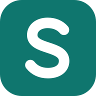

  

<h1 align="center">Steward</h1>

A coding-agent desktop app with a resident bot.

> [!IMPORTANT]
> Steward is an **unofficial** fork based on the [T3 Code](https://github.com/pingdotgg/t3code) source code. It is not affiliated with, endorsed by, or maintained by T3 Tools, Inc.

Steward is T3 Code's desktop app plus one resident bot. The bot has its own Home thread, persona, and memory. When a task comes in, it opens threads in your projects and hands the work to helper bots.

## Install

Steward ships for **Windows x64** only.

1. Download `Steward-<version>-x64.exe` from [Releases](https://github.com/RengarLee/t3codebot/releases).
2. Run it. Steward installs as its own app, next to T3 Code if you have it.
3. Steward updates itself from this repository's releases.

You also need one coding agent installed and signed in, for example [Claude Code](https://claude.com/product/claude-code) (`claude auth login`) or [Codex CLI](https://developers.openai.com/codex/cli) (`codex login`).

## Using it with T3 Code

Steward and T3 Code share the same data folder, `~/.t3`. Threads you create in one show up in the other.

- **Run one app at a time.** Both apps lock the data folder, so close one before you open the other.
- **Use T3 Code Nightly.** Steward follows T3 Code's nightly builds and can upgrade the shared database. Older T3 Code releases may not open it afterwards.
- **Back up before the first launch.** Copy `~/.t3/userdata/statev2.sqlite` somewhere safe before you open Steward for the first time.

## Using it from your phone

There is no Steward phone app. Use the official T3 Code app for [iOS](https://apps.apple.com/us/app/t3-code-remote-claude-more/id6787819824) or [Android](https://play.google.com/store/apps/details?id=com.t3tools.t3code). It connects to Steward as it would to any T3 Code computer.

- **Connect** by scanning Steward's pairing QR code over your local network or Tailscale, or through T3 Connect by signing in to the same T3 account on both. T3 Connect is T3's own service and account system. Steward only uses it.
- **Bot threads work as normal threads.** You can chat with the bot's Home thread and its helpers and approve their actions. The bot's settings, persona, and memory editors are only in the desktop app.
- **Versions can drift.** Steward follows T3 Code's nightly builds. If the store app is older, it may say the client is not supported until it updates.

## What is different from T3 Code

- **No usage analytics.** Steward sends no usage data.

## License

The source code is MIT licensed. See [LICENSE](../LICENSE). It keeps the original T3 Code copyright notice. The T3 Code name, logos, and icons belong to T3 Tools, Inc. and are not part of that license (see [TRADEMARK.md](../TRADEMARK.md)).
